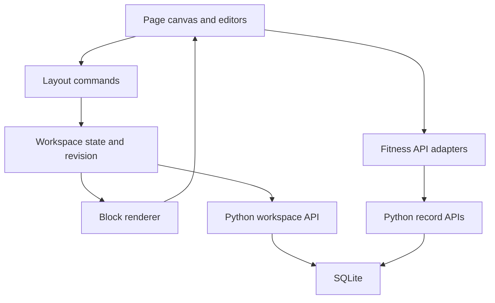

# FitnessOS frontend master document

**Prepared: 19 November 2026**  
**Status: source audit, design direction, and staged implementation plan. The first page-canvas increment is implemented; later phases remain proposed.**

**Implementation update, 19 November:** A first page-canvas increment is now in the working tree. `frontend/workspace_pages.js` adds persisted pages, subpages, editable text/heading/section/divider blocks, tool/action links, and a live recent-set view. Blocks can be selected with checkboxes or a desktop canvas rectangle and moved between sections or pages with a dialog; up/down controls offer another route. The Python workspace validator now accepts and checks page/block trees. Existing section shortcuts are copied into initial pages with a tool link, while the original shortcuts remain available. The old workspace endpoint and JSON backup carry this additional data; it is not the full versioned schema or conflict-safe save coordinator proposed below. Mobile, visual, microphone, live food lookup, and browser interaction checks still need direct testing. All later phases and proposals remain open.

Read `../AGENTS.md` first. It remains the repository's source of truth. This document expands the frontend direction into concrete designs and engineering work; proposed details here are not automatically accepted product decisions.

## 1. The central finding

FitnessOS currently has a substantial collection of fitness tools inside fixed screens. It has a dark theme, a set-entry dialog, quick actions, a customizable tree of navigation links, and persistent records. It does **not** yet have a page composition system in which the user can move actual content and tools between nested sections.

The missing foundation is the distinction between:

1. **Pages:** destinations such as Training, Nutrition, or a personally named Chest Day page.
2. **Blocks:** the content inside a page: headings, notes, collapsible sections, workout controls, charts, and record views.
3. **Records and views:** the saved fitness data and the different ways a page displays that same data.

Changing the order of shortcuts to fixed screens addresses navigation customization. Avik's request for sections within sections, movable by the user, calls for composition of the page itself. The recommended next experiment is one customizable Training page that contains a nested section, a note, a workout launcher, and a filtered set-history view, all connected to the existing Python backend.

This is a recommended experiment, not a newly declared first-release scope. Preserve the working tools while introducing it.

### How to use this document

- Sections 2–4: desired experience, current implementation, and missing work.
- Sections 5–7: Notion analysis, segmentation model, and visual design.
- Sections 8–12: architecture, JavaScript contracts, algorithms, and backend dependencies.
- Sections 13–15: implementation order, test criteria, and decisions still open.
- Section 16: research sources and evidence limits.

The examples use **JavaScript**, the language already used by this browser frontend. Java is a different language; adding Java is unnecessary for these interactions. Python remains responsible for backend validation and persistence.

## 2. What Avik has actually asked for

### 2.1 Confirmed direction

These requests are supported by the current `AGENTS.md`, the conversation excerpts available for this audit, and the retrieved November discussion. The discussion timestamps span 17 November UTC / 18 November India time.

| Request | Practical frontend meaning | Completion evidence needed |
| --- | --- | --- |
| Black as the dominant colour; supplied light/dark palettes | A coherent dark workspace, with a usable light alternative and restrained contextual colour | Both themes cover every screen, popup, status, and empty state |
| Rounded corners | Consistent control, menu, dialog, and grouping radii | A shared design scale, not different radii added per feature |
| Literary typography | Readable, editorial page titles and optional serif content | Font settings affect the intended content consistently |
| Customization and emojis | User-owned names, icons, colours, ordering, and page organization | Preferences survive reload and backup/restore |
| Sections, subsections, and deeper subsections | Real containers for content, with visible hierarchy | Move a section with all its children without losing content |
| User-movable content | Reorder and reparent meaningful page content | Mouse, touch-friendly menu, and keyboard alternatives |
| Desktop-style region selection | Select multiple blocks using a rectangle from empty space | Selection does not interfere with typing, controls, or scrolling |
| Satisfying, almost addictive navigation | Fast orientation, predictable return paths, useful shortcuts, small responsive feedback | Common tasks take few actions and do not lose context |
| Popups, dropdowns, and faster logging | Contextual editors instead of long detours through forms | Every entry point opens the same editor with correct context |
| At least 20 common gym exercises | Built-in suggestions shared across logging and routines | Catalogue consistently available, without invented exercise history |
| Exercise editor with last entered values | Show previous compatible values and prepare a reviewable draft | Correct exercise, unit, load convention, and last-entry semantics |
| Four load adjustments | `−2s`, `−s`, `+s`, `+2s`, where `s` is user-set and initially 2.5 kg | Correct rounding, clear unit, no negative load, saved increment |
| Detailed nutrition and food lookup | Macro/micronutrient snapshots, portion calculations, searchable foods | Unknown stays unknown; selected food and quantity survive correctly |
| Complete voice entry | Reliable transcription-to-review-to-save flow | Current strength grammar is only part of this; broader scope remains open |
| Changes integrated through the rest of the app | One feature must work through recent items, favourites, routines, history, totals, and recovery | Cross-feature acceptance checks, not only a new standalone screen |
| Browser first, excellent on a phone | Responsive navigation and comfortable touch input | Real-phone keyboard, relaunch, scrolling, and history checks |
| Python data/backend layer | Browser UI may use normal web technologies | No frontend rewrite silently removes Python |

Interpret “addictive” as enjoyable ease of use and visible personal ownership. The current direction does not require streak penalties, public rankings, notification pressure, or a social feed.

### 2.2 Existing prototype workflows to preserve

Account setup/sign-in and Remember me; strength sets; recent exercises and favourites; reusable exercises/workouts/days; workout sessions; calendar history; body entries/profile/trends; calories and personal foods; water/sleep/steps/check-ins; private progress photos; reviewed voice set drafts; and guarded JSON export/restore.

These are implemented prototype workflows. Their presence does not mean every interaction has been accepted or verified on a phone.

### 2.3 Earlier preferences and larger ideas

The discovery questionnaire and follow-ups mention rest timers, editable rest, reps-in-reserve, warm-up sets, confirmation settings, estimated one-rep maximum, deletion recovery, offline entry, reminders, cardio/sports, wearables, gamification, and ML ideas. Their status is governed by `AGENTS.md`: retain them in the backlog and revisit them when their workflow enters scope. Do not treat an older affirmative answer as overriding the later scope distinctions.

Recommended additions in this document—slash insertion, page duplication, column groups, layout undo, saved views, command search, and an emoji picker—are implementation proposals for achieving the requested experience. Exact controls and limits still need feedback.

## 3. Audit of the current code

### 3.1 Evidence and verification boundary

The audit covers the **working tree**, including existing uncommitted edits and untracked implementation files. Git has an `origin` remote for `avik756/FitnessOS`. No commit, push, deployment, or application rewrite was performed for this document.

Reviewed the browser HTML/CSS/JavaScript, shared backend routes and workspace/nutrition storage, existing tests, current instructions/changelog, and earlier product notes. Function names and line numbers below refer to the inspected working tree and can shift after edits.

Current checks run on 19 November:

| Check | Result | What it establishes |
| --- | --- | --- |
| `python -m unittest discover -s backend -v` | 29 tests run: 23 passed, 6 HTTP tests errored with `WinError 10013` during local requests | Storage/validation tests passed; HTTP integration could not be verified in this execution environment |
| `node frontend/test_voice.cjs` | Passed | The existing small parser's covered cases |
| `node frontend/test_set_save.cjs` | Passed | Covered save, repeat, failure, and concurrent-submit behavior in a simulated DOM contract |
| Live browser inspection | App-access approval timed out | No visual browser pass was completed |
| Real phone, microphone, live food lookup | Not performed | These remain unverified |

The previous changelog reports a successful HTTP run in another session. That is historical evidence, not the result of this run. A socket access failure is not proof of an application defect. Likewise, parser tests are not microphone tests, and source inspection is not a screenshot review.

### 3.2 File map and responsibilities

| File | Current responsibility | Consequence for the redesign |
| --- | --- | --- |
| `frontend/index.html` | Fixed screens, sidebar/mobile navigation, core forms, Quick add dialog; ordered deferred scripts | Extract shell and screen components gradually; do not copy global form IDs into blocks |
| `frontend/app.js` | Auth-aware fetch, hash routing, overview, sets, favourites, history, progress, backup and restore | Several different responsibilities and shared globals; extract API/router/set-editor boundaries |
| `frontend/features.js` | Body/profile/calories, calendar/day details, routine creation, common read/save helpers | Reuse data logic, give reusable views explicit inputs and scoped DOM roots |
| `frontend/journal.html` | Fragment containing daily journal, sessions, foods, and photos screens | Async loading needs an explicit ready/error state |
| `frontend/journal.js` | Fragment loading, journal/session/photo flows, comparison charts, route refresh | Currently adds behavior to other screens and replaces `renderBodyTrend`; isolate ownership |
| `frontend/workspace.js` | Set editor, load increments, previous-set lookup, layout persistence, tree, movement, selection, toast | Split fitness editor from workspace editor; current tree items point at routes |
| `frontend/nutrition.js` | Adds nutrient fields, FoodData Central search, portion scaling, summary | Extract a reusable food editor and pure calculations |
| `frontend/voice.js` | Small strength command grammar and browser recognition | Keep draft-only behavior; separate transcription from intent parsing |
| `frontend/appearance.js` | Loads cached theme/font before display | Useful foundation; browser cache is not server persistence |
| `frontend/style.css` | Original styling plus successive monochrome/theme overrides | Consolidate into tokens and component rules before further overrides accumulate |
| `frontend/login.html`, `login.js` | Account setup/sign-in and Remember me | Include auth in visual/state checks; preserve current session model |
| `backend/app.py` | HTTP/API and explicit static asset mapping | New JS/CSS modules require serving support; adding files alone is insufficient |
| `backend/features.py` | Body/nutrition/routines/workspace validation and SQLite persistence | Current workspace shape supports links, not the proposed page/block document |
| `backend/journal.py` | Journal/workout/photo data and validation | Retain current domain rules when embedding tools |
| `backend/exercise_catalogue.py`, `food_lookup.py` | 24 built-ins; server-side FoodData Central lookup | Extend metadata/provider states deliberately rather than replacing with frontend duplicates |
| `public/index.html`, `vercel.json` | Separate static public preview | Localhost functionality does not automatically reach the Vercel preview |

### 3.3 Existing interaction architecture

`showRoute()` in `app.js:103` hides and shows known `[data-view]` sections. Routes identify tools such as `#calories`, not user-created pages. Multiple scripts separately listen to `hashchange` and refresh data. `journal.js:init()` fetches a fragment and appends more screens later.

The set editor in `workspace.js` physically moves the existing `.entry-card` into a native `<dialog>` and moves it back when closed. This usefully preserves one form and one save path. It also couples editor lifecycle, routing, DOM ownership, and workspace initialization. The redesign should preserve the single editor while giving it an explicit controller.

The current workspace data is approximately:

```js
{
  theme: "dark",
  font: "serif",
  steps: { "fitnessos-step:barbell bench press:kg": 2.5 },
  sections: [
    { id: "training", title: "Training", emoji: "🏋️",
      route: "workouts", parent: null, color: "default", collapsed: false }
  ]
}
```

Sections have a route and optional parent but **no content blocks**. `render()` creates controls and links; clicking a link navigates to an existing screen. The sidebar uses cloned links; it is not a second full tree editor. The backend currently limits the serialized layout to 30,000 characters and 150 sections (`validate_workspace()`), and stores the workspace as one JSON value in SQLite.

### 3.4 What already works in code and should not be described as missing

- Dark/light theme variables and serif/sans/mono choices exist. Theme settings extend to auth and dynamic screens.
- Nested section links have create/edit, emoji/colour input, collapse, checkbox selection, rectangle selection, drag reordering, Shift-drag nesting, and a Move selected dialog.
- Previous compatible set lookup sorts by insertion ID, matching **last entered**, rather than last activity date. Request-generation protection prevents some stale responses overwriting changed drafts.
- The editor offers four increment buttons, Save, and Save & add another. Recent, favourite, and other exercise paths have been integrated with it.
- The shared catalogue includes 24 common exercises; unlogged exercises have no fabricated history.
- Nutrition contains 12 optional nutrient fields, stored snapshots, scaling for personal-food portions, database lookup UI, and daily coverage counts.
- Browser recognition and typed commands produce a reviewable strength draft. They do not auto-save it.
- Successful writes and failed refreshes are distinguished in several save paths. Set saves lock submit controls and retain drafts on failure.
- Export/restore includes workspace and nutrients in backup v5, with older backup compatibility and guarded restore behavior.

### 3.5 Specific gaps and risks visible in source

| Finding | Evidence | Why it matters | Planned remedy |
| --- | --- | --- | --- |
| Custom sections only open fixed routes | `workspace.js:126–247`; `route` property | User cannot put nutrition and training content together on one page | Page/block model and typed fitness-view blocks |
| Different sections can share the same URL | Link is `#${item.route}` | Reload/Back cannot identify the specific custom section | Stable `#page/<id>` routes; explicit tool routes during migration |
| Breadcrumb is only set in custom link click handlers | `workspace.js:219–223` | Direct routes, Back, and fixed links can leave it empty or stale | Derive from active page ID and ancestors on every navigation |
| Custom and fixed navigation coexist | `index.html` plus inserted `.workspace-navigation` | Duplicate destinations and unclear hierarchy | Separate Pages, Shortcuts, and Tools in one coherent navigation model |
| Sidebar lacks full tree interaction | Sidebar gets cloned links, collapse controls remain on overview | Managing hierarchy requires returning to the home editor | Disclosure controls and page menus in sidebar; mobile page drawer |
| Mobile removes nesting indentation | `style.css:339` | The parent/child relationship becomes harder to see | Cap indentation and add ancestor context; never erase hierarchy |
| HTML drag/drop depends on Shift for nesting | `workspace.js:210–214` | Poor discoverability and no touch equivalent of Shift | Explicit before/inside/after targets and Move menu |
| Selection applies only to section rows | `workspace.js:230–244` | Cannot select actual page content | Canvas-level block selection with text/control exclusions |
| Workspace save is whole-state and queued | `persist()` at `workspace.js:149–154` | Earlier completion can show “saved” while later work is pending; failed state needs explicit retry | Revision-aware queue, pending counts, retry and conflict handling |
| No server revision check | `save_workspace()` replaces JSON | Two tabs can overwrite one another | Compare expected revision in a transaction |
| No layout undo, duplicate, trash, or restore UI | No corresponding workspace commands | Rearrangement is harder to experiment with safely | Reversible structural commands; deleting layout must not delete fitness records |
| Theme rules accumulate in one cascade | Repeated root/surface rules around CSS lines 227 and 290 | New screen styling can regress earlier screens | One token source and explicit component states |
| Serif affects selected elements only | `style.css:303` | Typography preference is not a full page typography system | Defined page-content vs control font roles |
| Success/error share the same colour | `style.css:334` | Text carries most of the distinction | Status icon/label and clear persistent placement; do not rely on colour alone |
| Set dialog has heading but no explicit dialog naming association | Creation at `workspace.js:1–4` | Assistive technology may not announce a useful dialog name | `aria-labelledby`, controlled focus entry/return, keyboard verification |
| DOM roots/global names prevent repeated widgets | `#set-form`, `#body-trend-chart`, global functions | Two instances of a view can conflict | Scoped render roots and instance IDs; single shared editing overlay |
| Body trend behavior is replaced at runtime | `journal.js:333–336` and existing listener in `features.js` | Multiple render paths/listeners obscure ownership | One exported chart component subscribed once |
| Broad refreshes run on route and record events | `journal.js:340–346`, `nutrition.js:106–107` | Unrelated requests and repeated rendering grow with new blocks | Source-specific invalidation, shared requests, mounted-view subscriptions |
| No durable draft/session-expiry recovery model | DOM-held forms; `apiFetch()` redirects on 401 | Reload/session expiry can lose an unsaved draft | Explicit in-session draft store first; persistent drafts only after storage policy decision |
| Detailed nutrition is a long expanded form | `nutrition.js:37–42` | Ordinary meal entry exposes 12 fields immediately | Macro summary plus expandable details and clear portion basis |
| Lookup configuration appears as raw backend error | `food_lookup.py` | User sees implementation configuration during normal entry | Friendly unavailable state; setup detail in settings/help |
| Voice is strength-only with a small grammar | `voice.js:2–34` | Broad “voice complete” claim would be inaccurate | Reliability pass; staged intent support with unresolved fields |
| New JS modules will not automatically be served | Explicit asset map in `backend/app.py` | An otherwise correct refactor can yield 404s | Update static serving and add asset/boot integration checks |

These are source-derived findings. Actual overflow, focus behavior, drag usability, touch behavior, and perceived visual density need browser testing. Terminal output displayed some symbols incorrectly; UTF-8 source inspection did not establish replacement-character corruption, so encoding damage is not recorded as a confirmed bug.

## 4. Gap register and priorities

**P0:** necessary for dependable integration. **P1:** central to the requested workspace. **P2:** polish or expansion after the core experiment. **Later:** earlier/open idea, not a current obligation.

| ID | Capability | Current state | Priority and dependency |
| --- | --- | --- | --- |
| F01 | Consistent shell and component styling | Present with layered overrides | P0; foundation for all screens |
| F02 | Stable custom pages and deep links | Missing; fixed routes only | P1; schema, router, migration |
| F03 | Nested content sections | Missing; nested shortcuts exist | P1; page/block schema |
| F04 | Move/reorder actual blocks | Missing | P1; structural commands and rollback |
| F05 | Region/multiple selection on page canvas | Partial, section list only | P1; selection state and pointer rules |
| F06 | Mobile and keyboard movement | Move menu exists for links; not complete canvas access | P1; visible hierarchy and focus rules |
| F07 | Notes/headings/dividers/toggles | Fixed headings only; no content editor | P1; limited block renderer |
| F08 | Inline fitness views | Fixed screens exist | P1; extract data adapters and scoped components |
| F09 | Layout saving/conflicts/retry | Whole-layout persistence exists | P0 before trusting editable pages |
| F10 | Undo/duplicate/archive | Missing for workspace | P1 for reversible layout experimentation; trash policy open |
| F11 | Command navigation/search | Quick add filters fixed actions | P1 navigation; broader record search P2 |
| F12 | Emoji/colour/font customization | Basic controls exist | P1 coherent application; richer picker P2 |
| F13 | Two-column page layout | Fixed CSS grids exist | P2; after reliable one-column nesting |
| F14 | Repeated set-entry integration | Implemented, test coverage limited | P0 preserve and verify all launch paths |
| F15 | Food database usability and coverage | Implemented provider requiring key | P1 provider states, portion UX, real-food evaluation |
| F16 | Nutrition views/filters and details | Basic totals and lists exist | P1 shared query view; P2 saved filters |
| F17 | Voice reliability and scope | Small strength draft grammar | P1 reliability; broader intents staged separately |
| F18 | History/progress view consistency | Existing calendar and charts | P1 reusable adapters; P2 richer filters/time-axis options |
| F19 | Templates that create page structure | Fitness routine templates exist | P2; never duplicate completed records implicitly |
| F20 | Phone usability | Responsive CSS exists | P0/P1 acceptance gate; real-device evidence missing |
| F21 | Recovery for new layout schema | Backup v5 handles old layout | P0 alongside page storage, not afterwards |
| F22 | Offline logging/sync/PWA | Not implemented | Open architecture decision, separate from theme/layout |
| F23 | Cardio, wearables, ML, richer reminders | Mostly planned areas | Later; not blockers for page composition |
| F24 | Rest/RIR/warm-up, e1RM, confirmation setting | Earlier preferences not completed by this audit | Revisit within workout scope; schema + UI work required |
| F25 | Full hosted application | Public deployment is static preview | Separate Python hosting/database workstream |

## 5. Deep analysis of Notion and what to borrow

This section studies documented product behavior, not Notion's private implementation. The proposed FitnessOS architecture is our design, not a claim about Notion's internal framework or database. Official pages were consulted on 19 November 2026; layouts can change.

### 5.1 The page is a composition surface

**Documented behavior:** Notion pages contain different block types, including text, images, and tables. Blocks can be rearranged from a handle, and supported block transformations are available through a menu. [N1]

**Analysis for FitnessOS:** The important property is that content has its own identity and position. A chart can be moved because it is a block with configuration, not because someone drags a screenshot. The block's configuration changes location; the workout records remain in their own database tables.

Give a page a calm title area and a mostly continuous canvas. Use spacing and heading hierarchy to separate ordinary content. Reserve bordered surfaces for editors, grouped metrics, callouts, or selected blocks. Turning every paragraph into a large card would preserve the current dashboard feeling rather than create a flexible document.

### 5.2 Pages inside pages

**Documented behavior:** Notion organizes pages inside other pages, with subpage creation available from the parent or sidebar. [N2]

**Analysis for FitnessOS:** A page and an inline section should have different meanings. Training → Chest Day can be a navigable page relationship. Inside Chest Day, Warm-up and Working sets can be collapsible sections. A toggle should not suddenly navigate away; opening a subpage should.

This distinction prevents the current ambiguity where “section” means a named shortcut. Use separate controls: **Add section** for an inline container, **Add subpage** for a new destination, and **Add shortcut** for another link to an existing tool/page.

### 5.3 A consistent block grammar

**Analysis for FitnessOS:** Once a user learns select, move, duplicate, and configure, those actions should behave consistently for a note, a chart, and a workout panel. The block registry supplies the common frame; the fitness component supplies its content and controls.

Do not permit arbitrary conversions that destroy meaning. A text paragraph may become a heading or callout; a strength-history view can switch its supported presentation. Converting a workout record into text would lose structured fields and must not be treated as a harmless formatting command.

### 5.4 Placement is spatial, but structure stays explicit

**Documented behavior:** Notion offers drag guides for column placement and movable dividers. Its documentation describes right-hand column content stacking beneath left-hand content on phones. [N3]

**Analysis for FitnessOS:** Use an ordered tree plus explicit column containers. Do not store arbitrary screen coordinates for every block. Coordinates break when the viewport, text size, or phone keyboard changes.

First ship one-column sections with before/inside/after drop targets. Later add a column group with two columns. On a phone, flatten columns in stored column order; preserve the desktop configuration. Reading and screen-reader order must match the visual order. Arbitrarily many narrow columns are unnecessary for the first experiment.

### 5.5 A database view is not the database

**Documented behavior:** Notion can display database content in table, board, calendar, list, gallery, and chart layouts, with view-specific filters/sorts. [N4] Linked data sources can display existing records elsewhere while respecting the source's access. [N5]

**Analysis for FitnessOS:** Today’s sets, Bench history, and a calendar can all read the same set records. A block stores a query and presentation choice, not copied rows. A saved record should appear wherever its filters match after invalidation.

Start with domain-specific sources—sets, meals, body entries, sessions, journal events. Avoid implementing a fully user-defined database engine. A fitness app benefits from fixed unit validation and known fields. Removing a view removes only the view. Editing a record affects its canonical data and therefore every view of it.

### 5.6 Navigation is a working tool

**Documented behavior:** Notion exposes nested pages and favourites in its sidebar, with resizing/collapse and page movement. [N6]

**Analysis for FitnessOS:** Show a page tree with clear expanded/current states, pinned destinations, recent pages, and a compact Tools section for existing screens during migration. Breadcrumbs must be computed from page identity, not remembered from the last clicked link. Two pages displaying the same source must still have different URLs.

Navigation should preserve the selected activity date, scroll position, and open workout when returning from a detail editor. A user should not need to remember whether they reached Bench through Exercises or Training to get back correctly.

### 5.7 Progressive disclosure keeps a powerful app quiet

**Documented behavior:** Notion uses contextual menus, slash commands, and keyboard block selection/movement. It distinguishes text editing from selected-block operations. [N1, N7]

**Analysis for FitnessOS:** Show only essential controls during logging. Block handles and menus appear on hover/focus on desktop and through an explicit Edit layout mode on touch. A selected block gets a small action toolbar. Numeric input retains normal text selection; a canvas Delete command cannot run while a field is being edited.

The existing Quick add dialog is a useful start, but navigation search, record creation, and block insertion are different contexts. They may share a command registry while presenting different allowed commands.

### 5.8 Personalization works best within a coherent system

**Documented behavior:** Notion supports page font styles, width settings, text/block colours, and page icons. [N8]

**Analysis for FitnessOS:** Offer title/icon, font, page width, and limited colour accents without asking the user to become a designer. Typography and spacing should remain readable after customization. The icon selected for a page must appear consistently in the sidebar, breadcrumb, search, and page heading.

Avik's supplied palette is a project preference; do not silently replace it with whichever Notion colours happen to be current. Keep structural dark surfaces distinct from optional block colours.

### 5.9 Templates and actions reduce repetition

**Documented behavior:** Notion database templates provide reusable page structure; buttons can perform configured actions. [N9, N10]

**Analysis for FitnessOS:** A Training page template could add a session launcher, recent sets, and notes. A Chest Day routine template defines planned exercises. These are different templates: page structure versus planned workout data. Starting a routine creates a session, but cannot assert that any planned set was completed.

Use a small action allowlist such as Open set editor, Start routine, Open history, or Add water draft. Do not allow arbitrary JavaScript in user-created button blocks. Until destructive actions have a reviewed design, no “clear all records” button belongs in the block picker.

### 5.10 Shared content has different semantics from a copy

**Analysis for FitnessOS:** Distinguish three operations explicitly:

- **Duplicate layout:** copy blocks/configuration with new block IDs; shared record views still reference the same data.
- **Copy note:** independent text copy, edited separately afterwards.
- **Reference a record/view:** show the existing data, not a new logged event.

A future synchronized-note feature would require its own shared-content identity and delete semantics. It is not needed to satisfy movable sections and should not be smuggled into the first block model.

### 5.11 Fitness entry needs stronger constraints than a general document

**Analysis for FitnessOS:** Keep freeform composition around strongly validated editors. Dates, loads, units, load conventions, servings, and unknown values are structured data. Do not turn them into arbitrary rich text because Notion permits flexible pages.

Use native controls where they work well, especially numeric and date input. A movable workout block should open the dependable central set editor; the page canvas should never infer a completed set from a checkbox unless that workflow is explicitly designed and confirmed.

### 5.12 What not to imitate in this increment

Teamspaces, shared permissions, live collaboration, universal formulas, arbitrary integrations, AI agents, and a full rich-text word processor do not follow from Avik asking for a Notion-like personal fitness workspace. They greatly expand implementation and failure modes. The useful subset is nested pages, typed blocks, linked fitness views, contextual actions, personalization, and reliable persistence.

## 6. The proposed segmented experience

### 6.1 Workspace layout

| Region | Desktop | Phone |
| --- | --- | --- |
| Navigation | Resizable/collapsible page tree; pinned pages; Tools | Pages drawer with nested disclosure and search |
| Top bar | Sidebar toggle, clickable breadcrumbs, command search, page menu | Current title, back/ancestor control, search/menu |
| Title area | Emoji, editable page title, optional small description | Same identity with compact spacing |
| Canvas | Ordered blocks; optional later columns | One column, preserved hierarchy, comfortable touch spacing |
| Entry overlay | Focused dialog, with optional later side peek | Full-height sheet/dialog fitting the visible viewport |
| Global actions | Quick add and active-session return | Existing bottom navigation adapted to Home, Log, History, Pages |
| Status | Layout save status near page controls; record-save status in editor | Same semantics; reachable and not hidden by keyboard |

Suggested default page map: Home; Training with routine/exercise subpages; Nutrition; Daily journal; Body & progress; History. Keep Photos and Backup accessible as protected/system tools. These are starter pages that the user can rename/reorganize, not a permanently hard-coded taxonomy.

### 6.2 One concrete page example

Page **🏋️ Training** contains, in order:

1. A title and optional short note.
2. An **Active workout** block with Continue/Start controls.
3. A **Today** section containing today's sets and a quick-entry action.
4. A **Routines** section with links to saved routine pages.
5. A collapsed **Review** section with a chosen exercise trend and recent history.

The user can move Review above Routines, nest the note inside Today, or move a chart to another page. None of those actions changes a set record. Clicking a set row opens the existing record detail/editor behavior supported by the API; until record editing is implemented, label the action View or Repeat rather than imply Edit works.

Page **🥗 Nutrition** could contain a daily macro summary, meals by time, an Add food button, a compact personal-food view, and an expandable nutrient table. All reference the same calorie/food sources already used by the fixed screens.

### 6.3 Supported blocks, in implementation order

| Block type | Stored configuration | Behavior |
| --- | --- | --- |
| `text` | Plain text initially | Editable note; no raw stored HTML |
| `heading` | Text and level 1–3 | Section title; optionally feeds a page outline |
| `divider` | Minimal styling | Visual separation; selectable/movable |
| `section` | Title, emoji, collapsed state | Container for ordered child blocks |
| `callout` | Text, icon, allowed colour | Optional emphasis, not mandatory chrome everywhere |
| `page_link` | Target page ID | Opens a stable page destination |
| `tool_link` | Allowed legacy tool route | Compatibility bridge for screens not yet extracted |
| `action` | Allowlisted command and parameters | Opens editor or creates a reviewed draft |
| `fitness_view` | Source, filter, sort, layout, visible fields | Reads records through a domain adapter |
| `metric` | Source/query plus supported aggregation | Shows recorded summary with coverage/units |
| `column_group` / `column` | Ordered columns and width proportions | Later desktop composition; stack on phones |

Only `section` and `column` accept arbitrary content children initially. A `column_group` accepts only columns. Leaf blocks cannot accept nested children. Page ancestry is separate from the block tree.

## 7. Visual specification

### 7.1 Palette provenance

The table distinguishes exact values visible in the available conversation from values recovered from the implementation. The complete original palette message was not returned by conversation retrieval; do not claim that every implementation value below was supplied verbatim by Avik.

| Token/colour | Light text / background | Dark text / background | Provenance |
| --- | --- | --- | --- |
| Default | `#37352F` / `#FFFFFF` | `rgba(255,255,255,.9)` / `#2F3437` | Available conversation; dark surface differs from current main canvas |
| Gray | `#9B9A97` / `#EBECED` | `rgba(151,154,155,.95)` / `#454B4E` | Light confirmed; dark implementation |
| Brown | `#64473A` / `#E9E5E3` | `#937264` / `#434040` | Light confirmed; dark implementation |
| Orange | `#D9730D` / `#FAEBDD` | `#FFA344` / `#594A3A` | Light confirmed; dark implementation |
| Yellow | `#DFAB01` / `#FBF3DB` | `#FFDC49` / `#59563B` | Light confirmed; dark implementation |
| Green | `#27675D` / `#E4EFEC` | `#4DAB9A` / `#354C4B` | Implementation; retain pending review |
| Blue | `#245B80` / `#E5EEF5` | `#529CCA` / `#364954` | Implementation; retain pending review |
| Purple | `#664590` / `#EDE7F4` | `#9A6DD7` / `#443F57` | Implementation; retain pending review |
| Pink | `#984268` / `#F5E6EE` | `#E255A1` / `#533B4C` | Implementation; retain pending review |
| Red | `#A13C35` / `#F9E6E4` | `#FF7369` / `#594141` | Implementation; retain pending review |

Current main dark canvas is `#191919`. Proposed visual treatment: retain that nearly black canvas, use `#2F3437` selectively for raised/editor surfaces, and give ordinary document sections the canvas background. Confirm actual appearance in the browser rather than infer it from token names.

Some supplied accent combinations may be too low-contrast for small essential text. Preserve the palette as a customization reference; use a readable foreground for controls, errors, and numerical values, and validate actual contrast. Colour names should map to tokens, never arbitrary inline CSS from stored content.

### 7.2 Recommended design tokens and defaults

| Property | Proposed starting point | Reason |
| --- | --- | --- |
| Page title | Georgia/serif, 36–40 px desktop, 28–32 px phone | Literary identity without oversized dashboard hero text |
| Page body | 16 px; serif/sans preference; line-height about 1.5 | Reading comfort |
| Controls/numbers | System sans; tabular numeric figures | Clear input and comparisons |
| Spacing | 4, 8, 12, 16, 24, 32 px | Predictable hierarchy |
| Radius | 6 px controls; 8 px menus; 10–12 px dialogs/groups | Rounded but restrained |
| Reading width | Around 800 px plus full-width option | Useful notes and flexible data pages |
| Sidebar | Start around 240 px; bounded resize | Adequate titles without dominating canvas |
| Phone touch area | Aim for at least 44 × 44 px controls | Comfortable interaction; proposed acceptance target |
| Motion | Small 120–180 ms transitions; reduced-motion mode | Feedback without slowing entry |

Use CSS custom properties for tokens, `minmax(0, 1fr)` in content grids, wrapping text for long titles, and visible focus rings. Ordinary text blocks should not have a permanent border. Display a thin accent guide for the precise drop position instead of highlighting an entire destination ambiguously.

### 7.3 Page/component states

Every data component needs loading, empty, populated, error/retry, and unavailable states. Every editor needs pristine, dirty, validating, saving, saved, failed, and save-outcome-unknown states where relevant. A successful save followed by failed refresh remains a successful save with stale display, not a failed write.

Use concise user-facing copy: “Food search isn't available. You can still enter a label.” Configuration instructions belong in settings/help. Preserve truthful local-storage wording: the current app saves in the computer's database, not on the phone and not in a cloud backup.

## 8. Architecture that can support the experience

### 8.1 Keep the current stack for the first experiment

Recommended: native browser ES modules, scoped components, a small explicit store, and the Python/SQLite backend. There is no need to select React, a full rich-text framework, or another backend merely to add a block tree. Reassess an established editor library if requirements expand to complex rich text, selection across formatted spans, paste fidelity, or collaborative editing.

Convert one component at a time. ES modules do not share top-level variables like the current classic scripts: an `export`/`import` migration must update every consumer of each extracted function. A temporary explicit bridge is acceptable; undocumented `window.*` dependencies should not multiply.

### 8.2 Proposed module boundaries

| Proposed file/module | Owns | Does not own |
| --- | --- | --- |
| `frontend/main.js` | Bootstrap, readiness, mounting, initial route | Domain calculations |
| `frontend/core/api.js` | JSON requests, auth/error classification | Rendering and toast wording |
| `frontend/core/router.js` | Parse/navigate routes, return locations | Page-tree mutation |
| `frontend/core/store.js` | State and explicit subscriptions | Arbitrary DOM access |
| `frontend/workspace/model.js` | Schema, selectors, ancestry and invariants | HTTP |
| `frontend/workspace/commands.js` | Insert/move/duplicate/archive operations and inverse commands | Fitness-record writes |
| `frontend/workspace/persistence.js` | Revisions, pending queue, retry/conflicts | Dialog components |
| `frontend/workspace/renderer.js` | Scoped block instances and disposal | Fetching every record independently |
| `frontend/workspace/selection.js` | Selection, visible order, rectangle hit testing | Native text selection inside inputs |
| `frontend/workspace/drag.js` | Pointer gesture state and drop intent | Persisting every pointer movement |
| `frontend/components/*` | Dialog, menu, picker, tree, status, view toolbar | Global singleton form IDs in reusable views |
| `frontend/fitness/set-editor.js` | One editor and its draft/controller | Page composition |
| `frontend/fitness/nutrition.js`, `journal.js`, `views.js` | Domain adapters and fitness UI | Generic editor mutation |
| `frontend/styles/tokens.css`, `shell.css`, `blocks.css`, `forms.css` | Shared appearance and responsive behavior | API assumptions |
| `backend/workspace.py` | Proposed schema migration, document validation, revision writes | Fitness calculations already elsewhere |

These are intended boundaries; do not create empty files for every name before there is code to move. Serve modules with the correct MIME types. Update the backend asset map or implement a restricted frontend-directory resolver that rejects traversal and does not expose databases or repository files.

### 8.3 State categories

| State | Examples | Persistence |
| --- | --- | --- |
| Canonical fitness data | Sets, meals, body entries, journal events | Existing Python/SQLite tables |
| Workspace document | Pages, blocks, view configurations, preferences | Versioned backend workspace document |
| UI session state | Selection, hover, active dialog, drag preview, scroll, request generations | Memory; never exported as fitness records |
| Drafts | Unsaved set, note edit, food quantity | Memory initially; optional device persistence is a separate decision |
| Derived state | Breadcrumbs, totals, visible rows, descendants | Recomputed from canonical inputs |

Do not store chart totals or copied records inside layout JSON. Do not make `localStorage` theme caching evidence of a successful backend save. Clear sensitive in-memory content on sign-out and photo relock.



## 9. Proposed data model and backend contracts

### 9.1 Workspace schema version 2

Example configuration, not executable code or an existing API response:

```js
{
  schemaVersion: 2,
  revision: 12,
  preferences: { theme: "dark", font: "serif", loadSteps: {} },
  pages: {
    "page-training": {
      id: "page-training", parentPageId: null, order: 0,
      title: "Training", icon: "🏋️", width: "reading", font: "inherit",
      archivedAt: null
    }
  },
  blocks: {
    "block-today": {
      id: "block-today", pageId: "page-training", parentBlockId: null,
      order: 0, type: "section",
      props: { title: "Today", icon: "📅", collapsed: false }
    },
    "block-sets": {
      id: "block-sets", pageId: "page-training", parentBlockId: "block-today",
      order: 0, type: "fitness_view",
      props: {
        source: "sets", layout: "table",
        filters: [{ field: "activity_date", op: "eq", value: "$today" }],
        sort: [{ field: "id", direction: "desc" }],
        columns: ["exercise", "reps", "load", "unit", "load_type"]
      }
    }
  }
}
```

Use either `parent + order` or explicit child arrays as the source of ordering, not both. This proposal uses `parent + order`, with an index built for efficient rendering. Each block belongs to exactly one page; moving a container across pages updates `pageId` on all descendants atomically. Page links reference pages without changing page ancestry.

`$today` is an allowlisted dynamic filter resolved from the user's local calendar date each time the view is evaluated. Literal dates stay literal. No `eval`, arbitrary expressions, raw SQL, CSS, or user-supplied HTML is accepted in configuration.

### 9.2 Structural invariants

- IDs are unique; referenced parents exist; archived parents cannot receive new active children.
- Neither page ancestry nor block ancestry may contain a cycle.
- A block's parent belongs to the same page, except a root uses `null`.
- Only approved container types accept children; type/props are validated together.
- Orders are deterministic integers per sibling group; normalize on structural edits.
- No duplicate placement of the same block ID. Duplication creates new IDs.
- Unknown schema versions fail with an actionable error; do not erase data by creating defaults.
- Unknown block types render a preserved “unsupported block” placeholder, subject to safe schema handling; do not silently discard their data on a client round trip.
- Limits must be explicit and identical client/server. Start with conservative measured limits; current 30,000-character link-layout budget cannot be assumed suitable for pages and notes.

For the first small prototype, versioned JSON in SQLite remains viable. Measure document size and latency before moving to normalized page/block tables. If normalized later, use transactions and preserve document IDs/revisions rather than redesigning the frontend contract again.

### 9.3 Proposed API changes

| Endpoint | Input | Output / failure |
| --- | --- | --- |
| Existing `GET /api/workspace`, upgraded | Authenticated session | `{schemaVersion, revision, document}` |
| Existing `POST /api/workspace`, upgraded | `{expectedRevision, mutationId, document}` | `{revision, mutationId, document}`; validation 400, revision conflict 409, auth 401 |
| Existing record APIs | Existing valid payloads | Existing canonical records; preserve behavior |
| Proposed query extension, only when needed | Allowlisted source/filters/sort/cursor | Rows plus continuation cursor; no arbitrary query language |

`document` contains preferences/pages/blocks; `schemaVersion` and `revision` are envelope metadata. The expanded example above shows them together for readability; implementation must choose one wire shape consistently.

Server save algorithm: authenticate → parse bounded request → validate schema and tree → begin transaction → check `expectedRevision` → return stored result if `mutationId` was already accepted → write document and increment revision → commit → return authoritative revision. The mutation lookup must take precedence over rejecting a retry of an already-committed request on stale revision. A reused mutation ID with different payload is rejected. On conflict, preserve the local draft and offer review/reload, not blind overwrite.

Record creation needs its own idempotency support before automatic retries can safely create sets or meals. A layout revision does not solve duplicate record submissions.

### 9.4 Migration from the existing workspace

1. Back up and validate the current state before migration; test on a disposable database first.
2. Convert each old section to a page, preserving its title, emoji, parent relationship, order, colour, and collapse preference where meaningful.
3. Add a `tool_link` inside each migrated page pointing to its former route. Preserve access immediately rather than guessing how to split every old screen.
4. Migrate theme/font/step preferences exactly, including existing per-exercise/unit keys.
5. Use a stable old-section-to-new-page mapping. Make migration transactional and repeat-safe; schema markers prevent running it twice.
6. Keep legacy tool routes working. Extract a tool to a reusable block only when its equivalent flow passes verification.
7. Add the new layout schema to backup validation/export/restore in the same change set. A proposed backup v6 would accept v1–v5 and migrate their layout on restore.
8. Validate the complete restore before writing; preserve the current refusal to overwrite a nonempty database unless Avik separately changes that product policy.

Unrecognized old fields must be deliberately preserved or explicitly handled, not quietly dropped. Test a default workspace, empty workspace, nested custom workspace, and repeated links to the same route.

## 10. JavaScript implementation contracts and algorithms

All function names in this section are **proposed** unless explicitly described as existing. Examples emphasize inputs, outputs, computation, and failure behavior rather than claiming production completeness.

### 10.1 Routing and orientation

```js
parseRoute(hash)
// Input: "#page/page-training" or a supported legacy tool hash.
// Output: {kind:"page", pageId} | {kind:"tool", tool} | {kind:"notFound"}.

getBreadcrumbs(pageId, pagesById)
// Output: [{id, title, icon}, ...] from root to current page.

navigateTo(target, {replace = false, returnTo = null} = {})
// Updates route, preserves explicit return context, requests page mounting.
```

`getBreadcrumbs` walks `parentPageId` using a visited set, reverses the collected ancestors, and reports corrupt ancestry instead of looping. Cost is O(depth). Navigation awaits required screen readiness, updates current-page accessibility state, and restores stored scroll on Back. An unknown route shows a recoverable not-found state instead of silently opening Home.

### 10.2 Rendering typed blocks

```js
const blockRegistry = {
  text: { mount: mountText, acceptsChildren: false },
  section: { mount: mountSection, acceptsChildren: true },
  fitness_view: { mount: mountFitnessView, acceptsChildren: false }
};

mountBlock({block, root, services, dispatch})
// Returns {update(nextBlock), destroy()}.
```

Build `childrenByParent` in O(N); sort sibling groups by `order`; render visible descendants. Scope DOM queries to `root`. Do not regenerate the entire active text editor on every keystroke: preserve focus, selection, and IME composition. Each mounted view owns and disposes its event subscriptions and pending requests. A failed chart should show a local error, not abort the entire page.

### 10.3 Safe move/reparent operation

```js
moveBlocks(document, {
  ids, targetPageId, targetParentBlockId, beforeId = null
})
// Output: {ok:true, nextDocument, inverseCommand}
//      or {ok:false, code, message}; input document is unchanged on failure.
```

Algorithm:

1. Resolve IDs and reject missing, archived, or disallowed target nodes.
2. Remove selected descendants whose selected ancestor is already moving. Moving a parent carries its subtree once.
3. Sort remaining roots by current visible/document order so selection order does not scramble them.
4. Reject a destination inside a moving subtree and reject incompatible parent types.
5. Validate `beforeId` belongs to the destination sibling list. A drop into the moving group itself is a no-op rather than an accidental append.
6. Remove roots from old sibling lists; insert them in the destination at the computed index.
7. Update moved subtree page IDs if crossing pages, then renumber affected sibling orders.
8. Revalidate structural invariants and return the next document plus enough previous placements for undo.

Build maps once. For small documents, O(N) traversal plus sibling sorting is adequate. Do not repeatedly scan the entire array for every ancestor during each pointer frame.

Example: A contains B; C is a sibling. Selecting A and B then moving under C produces C → A → B, not two copies of B. Moving C into B in that resulting tree is rejected as a cycle.

### 10.4 Drag intent and selection

```js
resolveDropIntent(pointer, targetRect, targetBlock, modifiers)
// Output: {placement:"before"|"after"|"inside", targetId} or null.

selectBlocksInRect({start, current, rects, initialIds, additive})
// Output: Set<blockId>; calculation only, no save.
```

Use the top/bottom edge zones for before/after and an explicit centre zone for inside eligible containers. Show the precise target before release. Do not require Shift to discover nesting. On touch, start from a handle or explicit selection mode, and always offer Move to / Move up / Move down.

Rectangle selection uses axis-aligned intersection:

```js
function intersects(a, b) {
  return a.left < b.right && a.right > b.left &&
         a.top < b.bottom && a.bottom > b.top;
}
```

Start only from canvas background/selection gutter with the primary pointer. Ignore pointerdown inside input, textarea, select, button, link, or editable text. Apply a small movement threshold so an ordinary click does not unexpectedly select a region. Rectangles and pointer positions must use the same coordinate system. Update hitboxes during auto-scroll, throttle visual updates with `requestAnimationFrame`, and commit one command on drop. Use pointer capture with cleanup on pointerup, pointercancel, lost capture, Escape, and component disposal. [T1]

Keep text selection separate from block selection. Shift-click extends over visible blocks; Ctrl/Cmd-click can toggle a block. Hidden children are not separately hit-tested; moving their selected parent still carries them. Keyboard selection/movement needs visible focus and an accessible action menu, not pointer-only affordances.

### 10.5 Layout undo and duplication

```js
applyWorkspaceCommand(state, command)
// Returns next state + inverse command + affected IDs.

duplicateSubtree(document, rootIds, destination)
// New IDs for every copied block; remap internal copied-block references.
// Fitness source references remain references to the original records.
```

Keep layout undo separate from native text-editing undo. Ctrl+Z inside an input edits the input. Layout Undo creates a new validated command against the current revision; it does not restore an old whole-document snapshot over unrelated new changes. Initially support undo within the current tab/session and explain that limit. Persistent trash and retention duration remain separate decisions.

### 10.6 Save coordinator

```js
queueWorkspaceChange(command)
// Applies validated draft state, queues one operation.

flushWorkspaceChanges()
// Promise<{revision, persistedCommandIds}>; keeps failed commands pending.
```

Maintain `acknowledgedDocument`, `draftDocument`, `serverRevision`, `pendingCommands`, and `inFlight`. Allow only one layout write at a time. Capture the exact command batch sent. On acknowledgment, remove only that batch, update revision, and replay still-pending commands over the acknowledged state. Display Saved only when no dirty/in-flight work remains. Coalesce title typing, but do not lose explicit structural commands.

On a timeout, retry the same mutation ID and payload only when the server supports idempotency. On 409, stop sending and preserve the local draft; fetch the authoritative state for a reviewed conflict path. On 401, handle authentication without falsely showing Saved. Do not automatically overwrite another tab's document with the local snapshot.

### 10.7 Exercise editor and load steps

```js
openSetEditor({exercise, activityDate, sessionId = null,
               unit, loadType, source, returnTo})
// Returns/opens a controller for a draft; does not save.

getLastCompatibleSet(rows, {exercise, unit, loadType})
// Returns highest insertion-ID match or null.

adjustLoad({load, increment, multiple, maximum = 10000})
// Returns {ok:true, value} or {ok:false, reason}.
```

For adjustment: reject blank/nonfinite load; reject nonpositive increment; accept only multiples −2, −1, 1, 2; compute `load + increment * multiple`; validate range; round at the supported precision. Do not turn blank into zero or silently clamp a negative result. Use scaled integer arithmetic if exact decimal stepping is required; define the supported precision in both UI and backend.

Example: 40 kg, increment 2.5 gives 35, 37.5, 42.5, 45 kg. Keep increments associated with exercise and unit as the current implementation does. Switching kg/lb must not silently reinterpret a numeric load; load a compatible draft or perform an explicit labelled conversion.

Maintain a draft generation counter so previous-set requests cannot overwrite values the user has typed, copied, or spoken. Keep “last entered on” distinct from activity date. Preserve the current choice to use insertion order for previous entry lookup; label it clearly when the user logs an older workout today.

```js
saveSet(draft, {keepValues, mutationId})
// Validate → send → receive saved record → invalidate affected sources.
// On successful Save: close, return focus, confirm record.
// On successful Save & add another: retain values/context, focus reps.
// On failure: retain draft; on unknown outcome: check history before retry.
```

Use the same function from page blocks, favourite/recent chips, routine sessions, history repeat, quick add, and voice review. Starting a new set normally uses the intended activity date. Repeating a historical set must make the date explicit, because the current `fillFromSavedSet()` copies the historical date too. Preserve workout association only while the chosen exercise/date still matches the session's rules.

### 10.8 Nutrition calculation and editor

```js
scaleNutrients(perBasis, quantity, basisQuantity)
// Output: nutrients with original units; null remains null.

summarizeNutrients(entries)
// Output per nutrient: {value, knownCount, entryCount, coverage}.

searchFoods({query, signal})
// Output: normalized results or typed unavailable/network/validation error.
```

For each known nutrient, `scaled = nutrient * quantity / basisQuantity`. Reject negative/nonfinite quantities and nonpositive bases. A database food may use a 100 g basis; a personal food may use a named portion. Do not assume a serving weighs 100 g. Keep calculation precision internally and round display values; snapshots must be consistent across calorie and personal-food routes.

For a daily total, sum only known values and count covered entries. Two meals where one has 20 g protein and one has unknown protein produce **20 g recorded, 1/2 entries covered**, not a complete daily total. An empty day should say No meals logged rather than imply confirmed zero intake.

Suggested food editor: Search / My foods / Manual tabs; selected food, brand/source, basis and amount at the top; calories/macros next; Micronutrients collapsed; Save meal and optional Save to my foods actions. Store source identity, quantity/basis, units, and the nutrient snapshot. Editing a saved food definition later must not rewrite old meal snapshots.

Provider work includes missing-key, timeout, no-results, missing-nutrient, and duplicate-name states. Verify FoodData Central mapping and portion basis against its official API documentation before changing calculations. Evaluate real search coverage with Avik's foods; do not promise comprehensive Indian dishes from the current provider.

### 10.9 Views and honest trends

```js
queryFitnessRecords({source, filters, sort, cursor}, context)
// Output: {rows, nextCursor, coverage}; allowlisted fields/operators only.

buildSeries(rows, {metric, unit, loadType, xMode})
// Output: points + unit/coverage/domain labels; missing values are omitted.
```

Begin by adapting current endpoints rather than inventing a general query service. When records grow, push bounded filtering/pagination to Python. For small local datasets: filter O(N), stable-sort O(N log N), then paginate. Resolve relative dates before query; use stable IDs to break ties.

Group strength data by exercise variant, unit, and load convention. Keep unknown loads out of a load series while retaining the rows in accessible history. Current charts explicitly space by entry, not elapsed time. Preserve that label or implement a true time axis deliberately. Do not call logging frequency a fitness improvement score.

Expose the data table alongside charts. Any future e1RM needs a named formula, applicability limits, and an explicit product decision; the new page renderer must not invent estimates.

### 10.10 Voice review

```js
parseVoiceDraft(transcript, context)
// Output: {intent, fields, unresolved, warnings, originalText}.

applyVoiceDraft(editor, result)
// Updates a reviewable draft, invalidates stale prefills, never saves.
```

First strengthen existing set parsing and recognition state handling: punctuation variants, exercise matching, unit/convention ambiguity, listening/stopped/error states, denied/unavailable microphone, correction, and cancellation. If the load convention is missing, mark it unresolved or visibly retain a choice for review; do not present an inherited value as recognized speech.

Next proposed intents: water, body weight, then meals selected from known foods. The same transcript must not silently become a different intent because another screen is open. Multiple-set commands require a review list with per-row errors and explicit batch behavior. Food voice input cannot manufacture nutrient values without a matched food/quantity. Add broader intents one at a time with actual utterance tests; an LLM service is not a prerequisite.

### 10.11 Command palette, emoji picker, and search

```js
findCommands({query, context, registry})
// Output: ranked allowed commands with labels, icons, shortcuts.

searchPages(query, pages)
// Output: stable page IDs + ancestor context; never ambiguous route names.

setPageIcon(pageId, emoji)
// Validates and updates one page property through workspace commands.
```

Prefer exact/prefix matches before substring matches, with recent/favourite items as a modest tie-breaker. For a small personal workspace, linear search is sufficient. Keep slash insertion local to the active blank/text block; global quick search should not trigger while typing a slash in a food label or URL. A simple curated emoji grid plus pasted Unicode is enough initially. Count/validate grapheme sequences appropriately; flags and joined emoji are not necessarily one code point.

### 10.12 Accessibility and lifecycle

Use native buttons, inputs, lists and `<dialog>` where practical. Dialogs need an accessible name, sensible initial focus, contained keyboard navigation, Escape behavior, and focus returned to the opener. [T2] A semantic nested list with disclosure buttons may be easier to implement correctly than declaring `role="tree"`; use the full tree keyboard contract if that role is chosen.

All structural actions need button/menu equivalents. Focus and selection must remain distinct. Announce completed moves and saves without reading every drag frame. A selected page icon cannot be the only accessible title. On photo lock/session expiry, clear mounted image URLs and sensitive caches; a photo block cannot bypass the existing server unlock check.

## 11. Integration map: what must update together

| Change | Required integration points | Typical incomplete implementation to prevent |
| --- | --- | --- |
| New page identity | Router, sidebar, breadcrumbs, search, links, backup | Rename works in one surface but not others |
| New block type | Registry, validator, picker, rendering, copy/move/archive, migration/export | UI renders it but backend strips/rejects it |
| New exercise source | Logger, routines, favourites, recent/library, comparisons | One page has 24 suggestions while another does not |
| Set save | Editor, active session, recent/history, overview, matching block views | Toast succeeds while other visible history is stale |
| Food save | Calories, personal foods, daily journal, source snapshots, nutrient totals | Library portion loses nutrient detail |
| Theme/font | Shell, auth, menus, inputs, charts, dynamic fragments, selection, errors | New UI dark while old control remains white |
| Workspace schema | Read/write validation, migration, revisions, export, old restore | Customized page disappears on restart or restore |
| Module extraction | Imports/exports, static asset serving, HTML script order, bootstrap | Valid JS never loads or references a vanished global |
| Photo embedding | Access status, expiration, page visibility, cleanup, backup rules | Hidden/duplicated view exposes locked content |
| Route change | Ready state, pending requests, selected date, session context, focus/scroll | Old async response paints the new screen |

Use source-specific invalidation such as `{source:"sets", ids:[id], activityDate, sessionId}` rather than a global “reload everything” event. Multiple mounted views of the same query share a request/cache entry. A mutation invalidates all affected views even if they are on another page; those views refresh when mounted.

## 12. Phone behavior and recovery boundaries

### 12.1 Concrete phone behavior

- Page drawer exposes the same nested pages; indentation is bounded, with a parent path when deeply nested.
- Edit layout is an explicit mode with handles, checkboxes, and a Move destination picker. Scrolling remains the default gesture.
- Desktop columns stack without changing saved placement.
- Set and food editors keep the main action reachable above the keyboard, with safe-area padding and enough vertical scrolling to reach every field.
- Input labels include units; decimal keyboards are requested where appropriate; zero remains selectable where valid.
- Returning from an editor restores the page and relevant date/session. Rotation or keyboard changes do not reset the draft.
- Test narrow widths, enlarged text, long exercise/page names, and both themes.

The current server binds to `127.0.0.1`, so another phone cannot use it directly via the laptop's network address. Real-device testing needs an explicitly chosen reachable development/hosting setup. Do not expose a server publicly or weaken authentication merely to complete a responsive-layout check. Voice availability and secure-context requirements must be verified on the chosen phone/browser.

### 12.2 Offline and persistence honesty

Layout customization does not make the app offline-capable. The current authoritative save is Python/SQLite on the computer. If offline phone logging becomes required, it needs browser-local durable storage, mutation IDs, a queue, sync/conflict rules, recovery, and explicit Saved on this device / Synced states. A service worker alone is not a record persistence strategy.

Initially preserve drafts in memory across navigation and show clear retry. Persistent device drafts need a policy for sign-out cleanup, shared devices, quota, and sensitive data. Do not silently store private photos/passwords or complete account data in browser storage.

## 13. Implementation plan with reviewable increments

Every increment should report all visible changes, including small ones, and distinguish implemented from tested. The earlier two-day window is dated context, not evidence this full plan fits two days. Estimates below are relative size, not completion promises.

| Phase | Work and files | Visible result | Gate before proceeding |
| --- | --- | --- | --- |
| 0 — Baseline and integration | Confirm current route/save behavior; add targeted browser fixtures when available; inspect CSS states and session-expiry handling | Existing screens remain dependable | Known defects recorded; test environment limitations separated from code failures |
| 1 — Shared foundations | Extract API/router/editor ownership, scoped components, theme tokens; update backend assets | Consistent shell, dialogs and statuses; no functional regression | Every existing entry path still saves once and refreshes correctly |
| 2 — Page persistence | Versioned page/block document, revision writes, migration and backup compatibility | Migrated custom pages open via stable URLs; legacy tools remain reachable | Reload/restart, conflict, malformed document and restore checks |
| 3 — First real canvas | Text/heading/divider/section/tool link, insert/menu controls, nested renderer | Training page with editable nested content | Child order and contents survive move/reload; focus remains usable |
| 4 — Move/select/undo | Structural commands, keyboard/menu movement, pointer drag, rectangle selection, layout undo | User can reorganize actual blocks | Cycle/no-op/parent-child-selection/cross-page cases; touch scroll preserved |
| 5 — Live fitness blocks | Extract session launcher, set history, nutrition summary and one trend through adapters | Real records displayed in customizable sections | Multiple views stay consistent; duplicate layout never duplicates records |
| 6 — Fast entry and nutrition polish | Unified set controller, compact food editor, lookup states, voice reliability | Shorter routine entry with clear drafts and feedback | All launch paths, quantities, unknown values and failed-save cases |
| 7 — Navigation and personalization | Page search, pins/recents, icon picker, width/font controls; then columns/templates | Workspace feels personal and easy to navigate | Direct links/Back/rename/move all agree across surfaces |
| 8 — Phone and recovery trial | Chosen device/browser, keyboard/touch/rotation/relaunch; export/restore comparison | Evidence that the complete workflow works on a phone | Five-workout evaluation; no lost/ambiguous records |

**Smallest valuable build sequence:** stabilize editor/router → pages/schema/recovery → a Training canvas with section + note + tool link → safe movement → one live set-history block. Do not wait for columns, a rich-text toolbar, or every fitness block before proving this sequence.

### 13.1 Suggested review checkpoints

1. Approve the feel of one fully themed page and editor after implementation, based on actual interaction.
2. Test real inline nesting and movement before adding more block types.
3. Confirm that a history block and the old History screen show the same saved record.
4. Evaluate phone entry with a real workout and a small set of actual foods.
5. Only then choose whether richer text/columns/templates justify further editor complexity.

These are feedback checkpoints, not blanket permission requirements for routine implementation.

## 14. Acceptance scenarios and failure definitions

### 14.1 Workspace correctness

| Scenario | Expected result | Failure |
| --- | --- | --- |
| Create Training → Chest Day page and nested Warm-up section | Page ancestry and inline section hierarchy remain distinct | A “section” only links to another fixed screen |
| Reload direct custom-page URL | Same page, current sidebar and correct breadcrumb | Home fallback or stale breadcrumb |
| Select parent and child; move once | Child travels once with parent | Duplicate/orphaned child |
| Drop parent into descendant | Clear rejection; no mutation | Cycle or renderer crash |
| Move block across pages | Entire subtree changes page atomically | Children remain on old page |
| Duplicate a history view | New layout block, same underlying records | Extra sets/meals created |
| Undo movement | Structure restored through a new valid command | Unrelated recent edits overwritten |
| Several rapid edits while saving | Saved only after final acknowledgment | Early success hides unsaved work |
| Save fails or connection drops | Draft visible, explicit retry/outcome state | Draft disappears or false success |
| Two tabs edit same revision | Conflict detected, local draft preserved | Last write silently destroys other edit |
| Restore old/new backup into disposable empty DB | Layout/preferences and fitness records retained | Silent layout reset, partial restore, or changed nutrients |

### 14.2 Fitness integration

Log from each of: recent exercise, favourite, library, routine session, history repeat, Quick add, custom block action, and voice review. Verify exactly one record, correct activity date/unit/load convention/session, successful return navigation, and refreshed relevant views.

Test last-value lookup while typing/changing exercises quickly. Test 2.5 increments, fractional loads, blank, zero, invalid step, and unit switch. Test failed save with Save & add another; values must remain reviewable.

For nutrition, compare manual entry, selected database food, and personal-food portion. Test 50/100/250 g against the same source, fractional portions, unknown nutrients, zero nutrients, no meals, and partial daily coverage. Changing a source definition must not rewrite old logged meals.

For photos, a newly mounted or duplicated view must remain locked until server-authorized. Lock/expiry must clear all active views. Use synthetic images for development tests.

### 14.3 Interface and accessibility

Keyboard-only path: navigate pages → open editor → enter values → save → return focus → move selected block through menu. Screen reader path: page title/current location, dialog name, field units, selection count, save result. Pointer path: text selection inside editor never initiates rectangle selection; Escape cancels a drag without saving.

Check 360 px, 390 px, tablet, and desktop widths as proposed samples, plus enlarged text. No body-level horizontal scrolling; wide data tables may have labelled local overflow. Check long titles, empty pages, unavailable provider, and failed fragment loading. Real-phone results are a separate gate from these viewport checks.

### 14.4 Performance and measurement

Proposed target: local interaction feedback visible within about 100 ms on Avik's laptop for a modest page; network persistence is measured separately. Test a synthetic 200-block document with nested sections and a few live views. Measure mounted-view request count, typing responsiveness, drag frame responsiveness, memory after repeated navigation, and document save payload size. Do not claim these targets are achieved without measurement.

Debounce text persistence rather than typing display. Commit one structural save per completed movement. Unmount hidden heavy views and release subscriptions/object URLs. Add pagination before loading years of records into every block. Virtualization is an optimization to justify with measurements, not the first implementation step.

## 15. Remaining decisions and recommended defaults

| Decision | Recommended starting point | Status |
| --- | --- | --- |
| Full Notion clone or focused composition? | Typed fitness blocks plus limited notes/structure | Proposal supporting requested direction |
| Frontend framework | Keep vanilla ES modules for first canvas experiment | No framework newly settled |
| First block text model | Plain text with heading/callout types; richer inline formatting later | Proposal |
| Nesting behavior | Real recursive tree with explicit protective limits and good navigation | Exact limits need testing |
| Page structure vs workout template | Separate entities and commands | Recommended architecture |
| Layout vs fitness record deletion | Layout removal never deletes source records | Required safety property of proposed architecture |
| Trash/undo retention | Session layout undo first; persistent retention to decide | Earlier seven-day preference not silently reinstated |
| Existing section migration | Convert to page + legacy tool link | Proposal; test before applying |
| Default font | Literary headings, readable controls, page content preference | Exact visual outcome needs review |
| Offline scope | No new offline promise during composition work | Still open |
| Voice completion scope | Reliable strength first, then selected additional intents | Broader scope still open |
| Food coverage | Evaluate current provider on actual foods | Not verified |
| Phone/browser | Use Avik's current device once confirmed | Historical OnePlus note is not current verification |
| Hosted rollout | Separate backend/database deployment work | Static preview remains separate |

## 16. Sources and provenance

### Repository and conversation evidence

- `../AGENTS.md`: current precedence, requirements, prototype state, scope distinctions.
- `../CHANGELOG.md`: 17–18 November direction, implementation, and integration corrections.
- `../frontend/` and the backend files cited in section 3: inspected working-tree source.
- `TESTING_ROUTINE.md`: current commands and workflow checks; some earlier v4 wording needs updating when recovery work is implemented.
- `DISCOVERY_QUESTIONNAIRE.md` and `followups.md`: earlier intent, subordinate to current instructions.
- `NEW_PROJECT_CONTEXT.md`: historical restart context; its “no application code” description is stale and was not used as current-state evidence.
- Available conversation excerpts and retrieved November frontend discussion: preferences, implementation request, and the complaint about incomplete cross-codebase integration. Full original message bodies were not available for every preference.

### Notion primary sources, consulted 19 November 2026

- **N1:** [What is a block?](https://www.notion.com/help/what-is-a-block)
- **N2:** [Create a subpage](https://www.notion.com/help/create-a-subpage)
- **N3:** [Columns, headings and dividers / page formatting](https://www.notion.com/help/columns-headings-and-dividers)
- **N4:** [Database views, filters, sorts and groups](https://www.notion.com/help/views-filters-and-sorts)
- **N5:** [Data sources and linked databases](https://www.notion.com/help/data-sources-and-linked-databases)
- **N6:** [Navigate with the sidebar](https://www.notion.com/help/navigate-with-the-sidebar)
- **N7:** [Keyboard shortcuts](https://www.notion.com/help/keyboard-shortcuts)
- **N8:** [Style and customize your page](https://www.notion.com/help/customize-and-style-your-content)
- **N9:** [Database templates](https://www.notion.com/en-gb/help/database-templates)
- **N10:** [Generate blocks and pages with buttons](https://www.notion.com/help/guides/automatically-generate-blocks-pages-with-buttons)

Notion's column help text contains differing tablet wording between its main explanation and FAQ. This document relies on its explicit phone stacking behavior and does not claim a verified tablet capability matrix. The study did not access a private Notion workspace or reverse-engineer proprietary code.

### Implementation references

- **T1:** [MDN: Pointer events](https://developer.mozilla.org/en-US/docs/Web/API/Pointer_events) and [setPointerCapture](https://developer.mozilla.org/en-US/docs/Web/API/Element/setPointerCapture).
- **T2:** [W3C APG: Modal dialog pattern](https://www.w3.org/WAI/ARIA/apg/patterns/dialog-modal/).

Use this document as the detailed frontend plan. Update implementation status and verification evidence after each actual increment; keep `AGENTS.md` authoritative and `CHANGELOG.md` concise.
